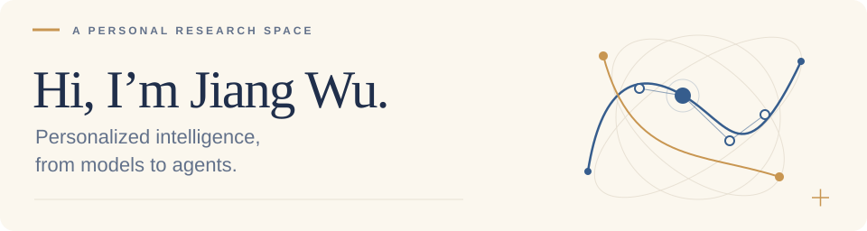

<picture>
  <source media="(max-width: 600px) and (prefers-color-scheme: dark)" srcset="assets/header-mobile-dark.svg">
  <source media="(max-width: 600px)" srcset="assets/header-mobile-light.svg">
  <source media="(prefers-color-scheme: dark)" srcset="assets/header-dark.svg">
  <source media="(prefers-color-scheme: light)" srcset="assets/header-light.svg">
  
</picture>

  
  
  

My research focuses on **personalized agents**, **personalized large language models**, and **personalized recommendation**. I study how models and agents can learn from individual preferences, feedback, and experience.

- **Personalized LLMs** · Post-training, lightweight adaptation, and preference-guided decoding that balance user preferences with explicit instructions.
- **Agent memory** · Remembering useful context and turning experience into reusable knowledge for personalized decisions.
- **Recommendation** · Language-model-based ranking and next-item prediction from item content, interaction histories, and feedback.

> **Currently building:** a benchmark for personalized agents. Interested in collaborating? [Let’s talk →](mailto:jiangwu@jiangwu.io)

### Selected publications

| Venue | Research |
| :--- | :--- |
| **EMNLP 2026**  | **[PsPLUG](https://aclanthology.org/2026.emnlp-main.43/)** Balancing implicit personalization and explicit style instructions with a lightweight plug-in. |
| **EMNLP 2026** | **[CARD](https://aclanthology.org/2026.findings-emnlp.44/)** Cluster-level adaptation with reward-guided decoding for personalized text generation. |
| **EMNLP 2026**  | **[AP-GRPO](https://aclanthology.org/2026.emnlp-main.1287/)** Anchor-gated phonetic alignment with policy optimization for pathological speech reconstruction. |

[More publications & research →](https://jiangllm.github.io/#publications)

---

I graduated from the **University of Southern California** in 2020. Away from research: swimming, classical Chinese poetry, and [*The Razor’s Edge*](https://www.penguinrandomhouse.com/books/109395/the-razors-edge-by-w-somerset-maugham/) by W. Somerset Maugham.

「東風夜放花千樹，更吹落、星如雨。」 辛棄疾 · <a href="https://zh.wikisource.org/zh-hant/%E9%9D%92%E7%8E%89%E6%A1%88%C2%B7%E5%85%83%E5%A4%95">青玉案·元夕</a>

